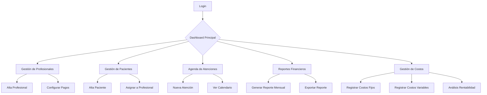

## 1. Product Overview
Sistema de gestión integral para centro médico que permite administrar profesionales, pacientes, agenda de atenciones y pagos por porcentaje o monto fijo. Incluye reportes mensuales de ingresos y gestión de costos fijos y variables.

El sistema resuelve la necesidad de centros médicos de controlar eficientemente sus operaciones, profesionales asociados, pacientes y finanzas en una plataforma unificada.

## 2. Core Features

### 2.1 User Roles
| Rol | Método de Registro | Permisos Principales |
|------|---------------------|------------------|
| Administrador del Centro | Registro único inicial | Acceso completo: profesionales, pacientes, agenda, reportes, costos |
| Profesional Médico | Registro por administrador | Ver/editar propios pacientes, ver propias atenciones y pagos |
| Secretaria/Recepción | Registro por administrador | Gestionar agenda, pacientes, ver reportes básicos |

### 2.2 Feature Module
Nuestro sistema de gestión médica consta de las siguientes páginas principales:
1. **Dashboard Principal**: Vista general del centro, estadísticas rápidas, accesos directos.
2. **Gestión de Profesionales**: Alta, edición, configuración de porcentajes/montos fijos por atención.
3. **Gestión de Pacientes**: Registro, historial, asignación a profesionales.
4. **Agenda de Atenciones**: Calendario de turnos, registro de atenciones realizadas.
5. **Reportes Financieros**: Reporte mensual de ingresos, pagos a profesionales, utilidades.
6. **Gestión de Costos**: Registro de costos fijos y variables, análisis de rentabilidad.
7. **Configuración**: Parámetros del centro, tipos de atención, valores por servicio.

### 2.3 Page Details
| Nombre de Página | Módulo | Descripción de Funcionalidades |
|-----------|-------------|---------------------|
| Dashboard Principal | Estadísticas | Ver total de atenciones del mes, ingresos totales, pagos pendientes, gráfico de tendencias. |
| Dashboard Principal | Accesos Directos | Botones rápidos para: nueva atención, nuevo paciente, nuevo profesional, ver agenda del día. |
| Gestión de Profesionales | Lista de Profesionales | Ver todos los profesionales con búsqueda, filtros por especialidad, estado activo/inactivo. |
| Gestión de Profesionales | Alta/Edición | Ingresar nombre, especialidad, teléfono, email, configurar tipo de pago (porcentaje o monto fijo). |
| Gestión de Profesionales | Configuración de Pagos | Establecer porcentaje (ej: 70%) o monto fijo (ej: $500) por tipo de atención. |
| Gestión de Pacientes | Lista de Pacientes | Ver pacientes con búsqueda por nombre/DNI, filtros por profesional asignado. |
| Gestión de Pacientes | Ficha del Paciente | Ingresar/editar nombre, DNI, teléfono, email, obra social, historia clínica básica. |
| Gestión de Pacientes | Asignación | Asignar/desasignar pacientes a profesionales específicos. |
| Agenda de Atenciones | Calendario Mensual | Vista mensual de turnos, colores por profesional, ver detalles al hacer clic. |
| Agenda de Atenciones | Registro de Atención | Registrar fecha, hora, profesional, paciente, tipo de atención, valor cobrado, observaciones. |
| Agenda de Atenciones | Confirmación de Pago | Marcar atención como pagada al paciente, generar comprobante. |
| Reportes Financieros | Reporte Mensual | Seleccionar mes/año, ver: total atenciones, ingresos brutos, pagos a profesionales, utilidad neta. |
| Reportes Financieros | Detalle por Profesional | Ver atenciones y pagos de cada profesional en el mes seleccionado. |
| Reportes Financieros | Exportación | Exportar reportes a PDF o Excel con gráficos incluidos. |
| Gestión de Costos | Costos Fijos | Registrar: alquiler, servicios, sueldos, seguros, montos mensuales fijos. |
| Gestión de Costos | Costos Variables | Registrar: insumos médicos, gastos eventuales, montos que varían mes a mes. |
| Gestión de Costos | Análisis de Rentabilidad | Comparar ingresos vs costos totales, ver margen de ganancia por período. |
| Configuración | Datos del Centro | Nombre, dirección, teléfono, CUIT, logo del centro médico. |
| Configuración | Tipos de Atención | Crear/editar tipos (consulta, práctica, estudio), establecer valores base. |
| Configuración | Usuarios del Sistema | Crear/editar usuarios administrativos, asignar roles y permisos. |

## 3. Core Process

### Flujo del Administrador del Centro:
1. Inicia sesión en el sistema
2. Configura los datos básicos del centro médico
3. Da de alta a los profesionales con sus respectivos porcentajes o montos fijos
4. Registra los costos fijos mensuales del centro
5. Cuando llega un paciente, lo registra en el sistema
6. Asigna el paciente al profesional correspondiente
7. Registra la atención con fecha, hora, tipo y valor
8. Al finalizar el mes, genera el reporte financiero
9. El sistema calcula automáticamente los pagos a cada profesional
10. Registra los costos variables del mes
11. Analiza la rentabilidad del centro

### Flujo del Profesional Médico:
1. Inicia sesión con sus credenciales
2. Ve su agenda del día con pacientes asignados
3. Atiende al paciente
4. Verifica que la atención esté registrada correctamente
5. Puede ver su historial de atenciones y pagos pendientes
6. Consulta sus reportes mensuales de ingresos

### Flujo del Paciente:
1. No requiere acceso al sistema
2. El personal administrativo lo registra
3. Se le asigna turno con el profesional
4. Paga la atención al centro
5. Recibe comprobante de pago

## 4. User Interface Design

### 4.1 Design Style
- **Colores principales**: Azul médico (#0066CC) y blanco, con acentos en verde (#00AA44) para indicadores positivos
- **Colores secundarios**: Gris claro (#F5F5F5) para fondos, gris oscuro (#666666) para textos secundarios
- **Estilo de botones**: Redondeados con sombra sutil, colores según acción (verde para guardar, rojo para eliminar, azul para primarios)
- **Tipografía**: Fuente sans-serif moderna (Inter o Roboto), tamaños: 16px para texto normal, 20px para títulos, 14px para textos pequeños
- **Estilo de layout**: Basado en tarjetas (cards) con bordes suaves y sombras, navegación lateral izquierda
- **Iconos**: Estilo lineal moderno, usando librería de iconos médicos (estetoscopio, calendario, usuarios, gráficos)

### 4.2 Page Design Overview
| Nombre de Página | Módulo | Elementos de UI |
|-----------|-------------|-------------|
| Dashboard Principal | Estadísticas | Tarjetas con números grandes, gráfico de líneas para tendencias, colores verdes para positivo, rojo para negativo |
| Dashboard Principal | Accesos Directos | Botones cuadrados con iconos grandes, hover effect con elevación sutil |
| Gestión de Profesionales | Lista | Tabla con filas alternadas, búsqueda en tiempo real, filtros desplegables |
| Gestión de Profesionales | Formulario | Campos con labels flotantes, validación en tiempo real, botón guardar en verde prominente |
| Agenda de Atenciones | Calendario | Grid mensual con colores por profesional, tooltips al hover, modal para detalles |
| Reportes Financieros | Vista General | Gráficos de barras y torta, tabla resumen, selector de período en header |
| Gestión de Costos | Formulario | Campos numéricos con formato automático, categorías predefinidas, fecha con datepicker |

### 4.3 Responsiveness
- Diseño desktop-first con adaptación responsive
- Sidebar colapsable en tablets
- Vista móvil con menú hamburguesa y tarjetas apiladas verticalmente
- Tablas con scroll horizontal en dispositivos pequeños
- Formularios con campos apilados en móvil

### 4.4 Interacciones y Animaciones
- Transiciones suaves (0.3s) en hover de botones y tarjetas
- Loading skeletons mientras cargan datos
- Notificaciones toast para acciones exitosas/error
- Modales con fade-in/out
- Validación de formularios con mensajes inline