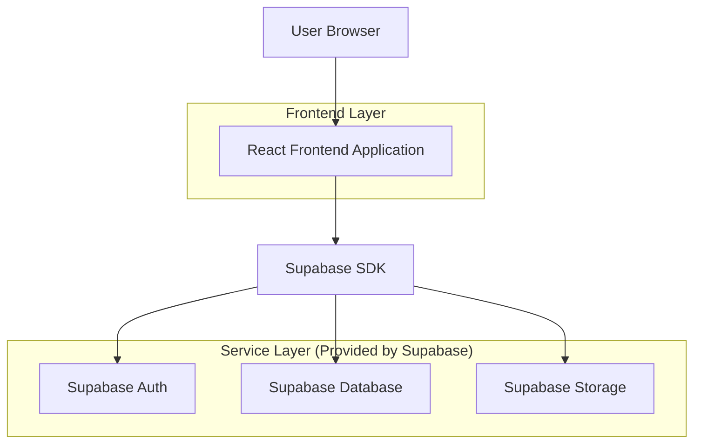
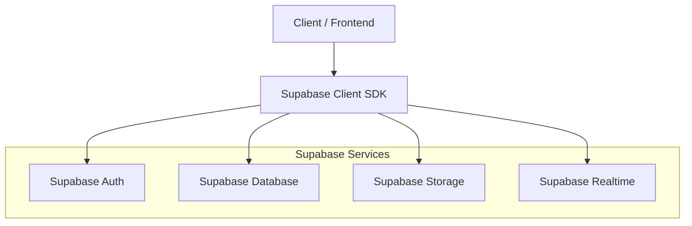
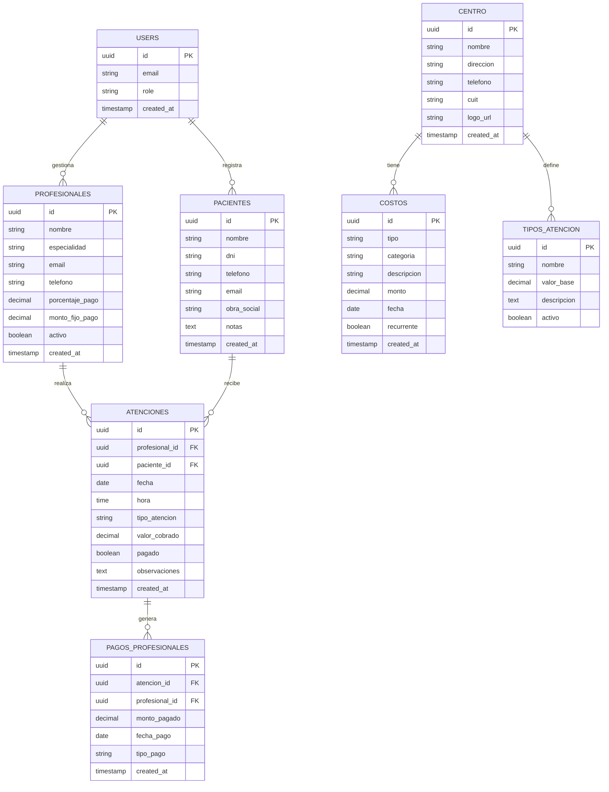

## 1. Architecture design



## 2. Technology Description

- Frontend: React@18 + tailwindcss@3 + vite
- Initialization Tool: vite-init
- Backend: Supabase (Backend-as-a-Service)
- Database: PostgreSQL (via Supabase)
- Authentication: Supabase Auth
- Storage: Supabase Storage (para archivos y reportes)

### Dependencias principales:
- @supabase/supabase-js: Cliente de Supabase
- react-router-dom: Navegación entre páginas
- recharts: Gráficos y visualización de datos
- date-fns: Manejo de fechas
- react-hook-form: Gestión de formularios
- lucide-react: Iconos

## 3. Route definitions

| Route | Purpose |
|-------|---------|
| / | Dashboard principal, estadísticas y accesos rápidos |
| /login | Página de autenticación de usuarios |
| /profesionales | Listado y gestión de profesionales médicos |
| /profesionales/nuevo | Formulario de alta de nuevo profesional |
| /profesionales/:id | Detalle y edición de profesional |
| /pacientes | Listado y gestión de pacientes |
| /pacientes/nuevo | Formulario de alta de nuevo paciente |
| /pacientes/:id | Historial y detalle del paciente |
| /agenda | Vista del calendario de atenciones |
| /agenda/nueva | Formulario de nueva atención |
| /reportes | Vista de reportes financieros |
| /reportes/mensual | Reporte detallado mensual |
| /costos | Gestión de costos fijos y variables |
| /configuracion | Configuración general del centro |

## 4. API definitions

### 4.1 Autenticación

```
POST /auth/v1/token
```

Request:
```json
{
  "email": "admin@centromedico.com",
  "password": "password123"
}
```

### 4.2 Tablas principales (via Supabase)

#### Profesionales
```sql
SELECT * FROM profesionales
INSERT INTO profesionales (nombre, especialidad, email, telefono, porcentaje_pago, monto_fijo_pago, activo)
UPDATE profesionales SET ... WHERE id = ...
DELETE FROM profesionales WHERE id = ...
```

#### Pacientes
```sql
SELECT * FROM pacientes
INSERT INTO pacientes (nombre, dni, telefono, email, obra_social, notas)
```

#### Atenciones
```sql
SELECT * FROM atenciones WHERE fecha BETWEEN '2024-01-01' AND '2024-01-31'
INSERT INTO atenciones (profesional_id, paciente_id, fecha, hora, tipo_atencion, valor_cobrado, pagado)
```

#### Costos
```sql
SELECT * FROM costos WHERE tipo = 'fijo' OR tipo = 'variable'
SELECT SUM(monto) FROM costos WHERE fecha BETWEEN '2024-01-01' AND '2024-01-31'
```

## 5. Server architecture diagram



## 6. Data model

### 6.1 Data model definition



### 6.2 Data Definition Language

#### Tabla de usuarios (users)
```sql
-- Tabla de usuarios (manejada por Supabase Auth)
-- Los usuarios se crean mediante el servicio de autenticación de Supabase
```

#### Tabla de profesionales
```sql
-- create table
CREATE TABLE profesionales (
    id UUID PRIMARY KEY DEFAULT gen_random_uuid(),
    nombre VARCHAR(255) NOT NULL,
    especialidad VARCHAR(255) NOT NULL,
    email VARCHAR(255) UNIQUE,
    telefono VARCHAR(50),
    porcentaje_pago DECIMAL(5,2) DEFAULT 70.00,
    monto_fijo_pago DECIMAL(10,2),
    activo BOOLEAN DEFAULT true,
    created_at TIMESTAMP WITH TIME ZONE DEFAULT NOW(),
    updated_at TIMESTAMP WITH TIME ZONE DEFAULT NOW()
);

-- create index
CREATE INDEX idx_profesionales_especialidad ON profesionales(especialidad);
CREATE INDEX idx_profesionales_activo ON profesionales(activo);

-- grant permissions
GRANT SELECT ON profesionales TO anon;
GRANT ALL PRIVILEGES ON profesionales TO authenticated;
```

#### Tabla de pacientes
```sql
-- create table
CREATE TABLE pacientes (
    id UUID PRIMARY KEY DEFAULT gen_random_uuid(),
    nombre VARCHAR(255) NOT NULL,
    dni VARCHAR(50) UNIQUE,
    telefono VARCHAR(50),
    email VARCHAR(255),
    obra_social VARCHAR(255),
    notas TEXT,
    created_at TIMESTAMP WITH TIME ZONE DEFAULT NOW(),
    updated_at TIMESTAMP WITH TIME ZONE DEFAULT NOW()
);

-- create index
CREATE INDEX idx_pacientes_nombre ON pacientes(nombre);
CREATE INDEX idx_pacientes_dni ON pacientes(dni);

-- grant permissions
GRANT SELECT ON pacientes TO anon;
GRANT ALL PRIVILEGES ON pacientes TO authenticated;
```

#### Tabla de atenciones
```sql
-- create table
CREATE TABLE atenciones (
    id UUID PRIMARY KEY DEFAULT gen_random_uuid(),
    profesional_id UUID REFERENCES profesionales(id) ON DELETE CASCADE,
    paciente_id UUID REFERENCES pacientes(id) ON DELETE CASCADE,
    fecha DATE NOT NULL,
    hora TIME NOT NULL,
    tipo_atencion VARCHAR(255) NOT NULL,
    valor_cobrado DECIMAL(10,2) NOT NULL,
    pagado BOOLEAN DEFAULT false,
    observaciones TEXT,
    created_at TIMESTAMP WITH TIME ZONE DEFAULT NOW(),
    updated_at TIMESTAMP WITH TIME ZONE DEFAULT NOW()
);

-- create index
CREATE INDEX idx_atenciones_fecha ON atenciones(fecha);
CREATE INDEX idx_atenciones_profesional ON atenciones(profesional_id);
CREATE INDEX idx_atenciones_paciente ON atenciones(paciente_id);

-- grant permissions
GRANT SELECT ON atenciones TO anon;
GRANT ALL PRIVILEGES ON atenciones TO authenticated;
```

#### Tabla de pagos a profesionales
```sql
-- create table
CREATE TABLE pagos_profesionales (
    id UUID PRIMARY KEY DEFAULT gen_random_uuid(),
    atencion_id UUID REFERENCES atenciones(id) ON DELETE CASCADE,
    profesional_id UUID REFERENCES profesionales(id) ON DELETE CASCADE,
    monto_pagado DECIMAL(10,2) NOT NULL,
    fecha_pago DATE NOT NULL,
    tipo_pago VARCHAR(50) NOT NULL, -- 'porcentaje' o 'monto_fijo'
    created_at TIMESTAMP WITH TIME ZONE DEFAULT NOW()
);

-- create index
CREATE INDEX idx_pagos_profesionales_profesional ON pagos_profesionales(profesional_id);
CREATE INDEX idx_pagos_profesionales_fecha ON pagos_profesionales(fecha_pago);

-- grant permissions
GRANT SELECT ON pagos_profesionales TO anon;
GRANT ALL PRIVILEGES ON pagos_profesionales TO authenticated;
```

#### Tabla de costos
```sql
-- create table
CREATE TABLE costos (
    id UUID PRIMARY KEY DEFAULT gen_random_uuid(),
    tipo VARCHAR(50) NOT NULL CHECK (tipo IN ('fijo', 'variable')),
    categoria VARCHAR(255) NOT NULL,
    descripcion TEXT,
    monto DECIMAL(10,2) NOT NULL,
    fecha DATE NOT NULL,
    recurrente BOOLEAN DEFAULT false,
    created_at TIMESTAMP WITH TIME ZONE DEFAULT NOW(),
    updated_at TIMESTAMP WITH TIME ZONE DEFAULT NOW()
);

-- create index
CREATE INDEX idx_costos_tipo ON costos(tipo);
CREATE INDEX idx_costos_fecha ON costos(fecha);
CREATE INDEX idx_costos_categoria ON costos(categoria);

-- grant permissions
GRANT SELECT ON costos TO anon;
GRANT ALL PRIVILEGES ON costos TO authenticated;
```

#### Tabla de tipos de atención
```sql
-- create table
CREATE TABLE tipos_atencion (
    id UUID PRIMARY KEY DEFAULT gen_random_uuid(),
    nombre VARCHAR(255) NOT NULL,
    valor_base DECIMAL(10,2),
    descripcion TEXT,
    activo BOOLEAN DEFAULT true,
    created_at TIMESTAMP WITH TIME ZONE DEFAULT NOW()
);

-- insert initial data
INSERT INTO tipos_atencion (nombre, valor_base, descripcion) VALUES
    ('Consulta general', 1500.00, 'Consulta médica general'),
    ('Consulta especialista', 2500.00, 'Consulta con especialista'),
    ('Práctica médica', 3000.00, 'Práctica o procedimiento médico'),
    ('Estudio médico', 1800.00, 'Estudio o análisis médico');

-- grant permissions
GRANT SELECT ON tipos_atencion TO anon;
GRANT ALL PRIVILEGES ON tipos_atencion TO authenticated;
```

#### Tabla de configuración del centro
```sql
-- create table
CREATE TABLE centro_config (
    id UUID PRIMARY KEY DEFAULT gen_random_uuid(),
    nombre VARCHAR(255) NOT NULL,
    direccion TEXT,
    telefono VARCHAR(50),
    cuit VARCHAR(50),
    logo_url TEXT,
    created_at TIMESTAMP WITH TIME ZONE DEFAULT NOW(),
    updated_at TIMESTAMP WITH TIME ZONE DEFAULT NOW()
);

-- insert default config
INSERT INTO centro_config (nombre, direccion, telefono) VALUES
    ('Centro Médico', 'Dirección del centro', 'Teléfono del centro');

-- grant permissions
GRANT SELECT ON centro_config TO anon;
GRANT ALL PRIVILEGES ON centro_config TO authenticated;
```

### 6.3 Políticas de seguridad (Row Level Security)

```sql
-- Políticas para profesionales
ALTER TABLE profesionales ENABLE ROW LEVEL SECURITY;

CREATE POLICY "Todos pueden ver profesionales activos" ON profesionales
    FOR SELECT USING (activo = true);

CREATE POLICY "Usuarios autenticados pueden gestionar profesionales" ON profesionales
    FOR ALL USING (auth.role() = 'authenticated');

-- Políticas para atenciones
ALTER TABLE atenciones ENABLE ROW LEVEL SECURITY;

CREATE POLICY "Ver todas las atenciones" ON atenciones
    FOR SELECT USING (true);

CREATE POLICY "Usuarios autenticados pueden gestionar atenciones" ON atenciones
    FOR ALL USING (auth.role() = 'authenticated');

-- Políticas para reportes financieros (vista)
CREATE OR REPLACE VIEW reporte_mensual AS
SELECT 
    DATE_TRUNC('month', fecha) as mes,
    COUNT(*) as total_atenciones,
    SUM(valor_cobrado) as ingresos_totales,
    SUM(CASE WHEN pagado THEN valor_cobrado ELSE 0 END) as ingresos_cobrados,
    SUM(pp.monto_pagado) as total_pagado_profesionales
FROM atenciones a
LEFT JOIN pagos_profesionales pp ON a.id = pp.atencion_id
GROUP BY DATE_TRUNC('month', fecha);

GRANT SELECT ON reporte_mensual TO anon;
GRANT SELECT ON reporte_mensual TO authenticated;
```